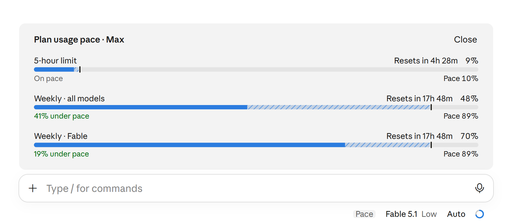

# usage-pace

A Claude Code mod that shows whether your plan usage is running ahead of or behind a steady burn until each limit resets.



The stock usage card tells you how much of each limit you have used. This mod adds the missing half: how much you *should* have used by now if you spread the limit evenly over its window. So you can tell at a glance whether you can afford a long session or need to slow down.

## What it shows

A small **Pace** chip sits in the composer footer, beside the model picker. Press it (or run `/usage-pace`) to open a panel above the prompt with one row per limit:

- **5-hour limit**, **Weekly · all models**, and the per-model weekly limit (for example **Weekly · Fable**) when the desktop app reports one.
- A bar with what you have used in solid blue, a **tick** at where a steady burn would be right now, and **stripes** for the room left before the tick. When you are past the tick, the stretch beyond it turns amber: that is the part to slow down for.
- The time until the reset as a countdown (`Resets in 1d 3h 12m`), the percent used, and a verdict such as `41% under pace`, `On pace`, or `12% over pace · runs out in 2h 5m`.

The panel refreshes every minute and on every turn. The chip itself never changes, so nothing in the footer moves while you work.

## Install

### With a slash command

At the prompt of a terminal session:

```
/plugin install usage-pace --marketplace nikableh/usage-pace
```

### From a shell

```
claude plugin install usage-pace --marketplace nikableh/usage-pace
```

Answer `y` to add the marketplace, then pick a scope. The **user** scope loads the mod in every session, including the ones the Claude desktop app starts.

### In the Claude desktop app

Where `/plugin` does not run: click **+** next to the prompt box, then **Plugins**, **Add marketplace** with `nikableh/usage-pace`, then **Add plugin**.

### Telling an agent to install it

If you want Claude Code itself to install the mod, paste this:

> Install the Claude Code plugin `usage-pace` from the marketplace `nikableh/usage-pace` at the user scope, with `claude plugin install usage-pace --marketplace nikableh/usage-pace`, and accept the marketplace when asked.

## Requirements

- Claude Code with hooks-module plugins (the "mods" API). The mod was built against Claude Code 2.1.309.
- A Claude subscription (Pro, Max or Team). On an API key, Bedrock, Vertex or a gateway there are no plan limits, and the panel says so.
- The per-model weekly row needs the Claude desktop app: it comes from the app's own usage helper, which terminal sessions do not have. Terminal sessions show the 5-hour and weekly rows only.

## Options

| Option | Default | What it does |
| --- | --- | --- |
| `label` | `Pace` | The fixed text of the footer chip. A picker over Pace, Usage, Plan usage and Limits in the config menu. |

Options live in `~/.claude/settings.json` under `pluginConfigs["usage-pace"].options`.

## How it reads your usage

- The engine hands the mod the 5-hour and weekly windows (`$.session.usage()` and the `session.measure` event). The desktop app's helper (`ccd_session_mgmt` / `get_usage`) adds the per-model window and the plan name. Both are read on every refresh and merged, the app's reading winning for a limit both name.
- Pace is linear: `expected = elapsed share of the window × 100`. "Under pace" means used is below expected, "over pace" above. The first 5% of a window shows "Window just started", since one request swings the pace by more than it means there.
- A limit the newest reading does not mention is kept from the last one. Right after a window resets the engine has no reading for it until your next request, and the app's helper has moments with none at all; without this the row would blink out.
- When the app's helper is unreachable or answers without limits, a dim line at the bottom of the panel says why.

Nothing leaves your machine: the mod reads what Claude Code and the desktop app already know and draws it.

## Known limits

- The chip's pill, size and hover shade, and the panel's grey frame, are the app's own styling for mod slots. A mod can draw inside them, not change them.
- The panel sits in the band above the prompt, which the app caps at eleven text lines. Three limits fit; a plan that reports more would scroll.
- The reset countdown needs the reset time; a limit read without one shows no countdown and no pace.

## Development

```
claude plugin validate .
claude plugin test .
```

The engine writes type declarations into `.claude-plugin/types/` the first time it loads the mod (`claude --plugin-dir .` does). After that, `tsc -p .` type-checks against them; before, `tsconfig.json` has nothing to extend and `tsc` fails. That folder is gitignored.

Layout:

- `hooks/register.tsx`: the hooks module. Registers the command, refreshes the readings, draws the chip (`SessionMode`) and the panel (`AbovePrompt`).
- `hooks/pace.ts`: pure functions. Pace math, countdown wording, parsing of both sources, merging, and the bar SVG.
- `hooks/pace.test.tsx`: tests for the math and for the chip and panel on the terminal and desktop surfaces.
- `types/index.d.ts`: the state contract (`PluginState`) and the value types.

## License

MIT, see [LICENSE](LICENSE).
